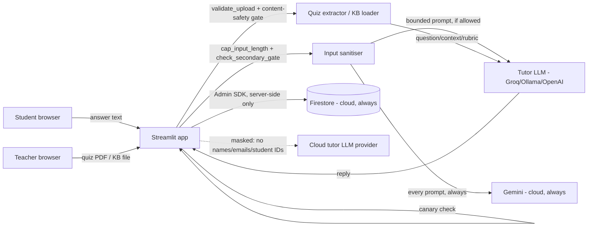

# Data flow (DP4 - institutional data sovereignty)

Where student/teacher data goes, and what leaves the institution's own infrastructure.

**What crosses the institution boundary:** only the question text, the student's
answer, and the rubric go to a cloud LLM provider (Groq/OpenAI), and only after
`rate_limiter._mask_sensitive_request` strips emails and student-ID patterns out
of the outbound text. Switching `LLM_PROVIDER=ollama` keeps the *tutor* model
local - it does **not** keep everything local: the secondary safety gate
(`InputSanitizer.check_secondary_gate`) always calls Google's Gemini API
regardless of `LLM_PROVIDER`, and Firestore is always Google Cloud too. The
only thing `LLM_PROVIDER=ollama` moves on-prem is the actual tutoring/feedback
generation.

**What never leaves Firestore:** student names/IDs tied to performance records,
audit log raw prompts, and the canary token's surrounding system prompt - the
audit logger redacts these fields before they're written anywhere (see
`1.5_security/audit_logger.py`).

**Client access to Firestore:** none. Every read/write goes through the
Streamlit backend over the Firebase Admin SDK, which bypasses Firestore
Security Rules entirely - `firestore.rules` (repo root) denies all direct
client access as a backstop in case a client key ever ends up somewhere it
shouldn't. **Note:** rules only take effect once deployed
(`firebase deploy --only firestore:rules`, needs a `firebase.json` pointing at
this file) - as of this pass that deploy step hasn't been done, so the file is
a correct, tested artifact but not yet live protection. See `1.5_security/README.md`.
