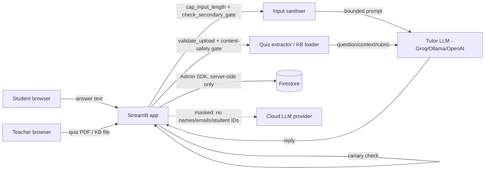

# Data flow (DP4 - institutional data sovereignty)

Where student/teacher data goes, and what leaves the institution's own infrastructure.

**What crosses the institution boundary:** only the question text, the student's
answer, and the rubric go to a cloud LLM provider (Groq/OpenAI), and only after
`rate_limiter._mask_sensitive_request` strips emails and student-ID patterns out
of the outbound text. Switching `LLM_PROVIDER=ollama` keeps everything local instead.

**What never leaves Firestore:** student names/IDs tied to performance records,
audit log raw prompts, and the canary token's surrounding system prompt - the
audit logger redacts these fields before they're written anywhere (see
`1.5_security/audit_logger.py`).

**Client access to Firestore:** none. Every read/write goes through the
Streamlit backend over the Firebase Admin SDK, which bypasses Firestore
Security Rules entirely - `firestore.rules` (repo root) denies all direct
client access as a backstop in case a client key ever ends up somewhere it
shouldn't.
